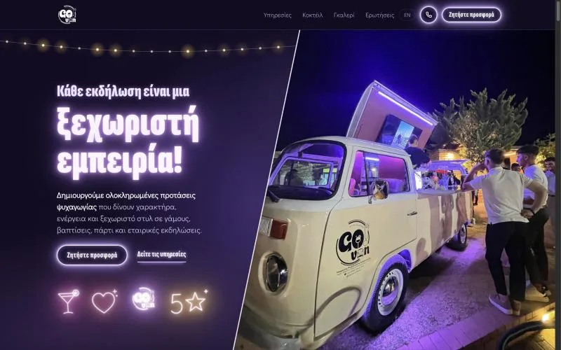
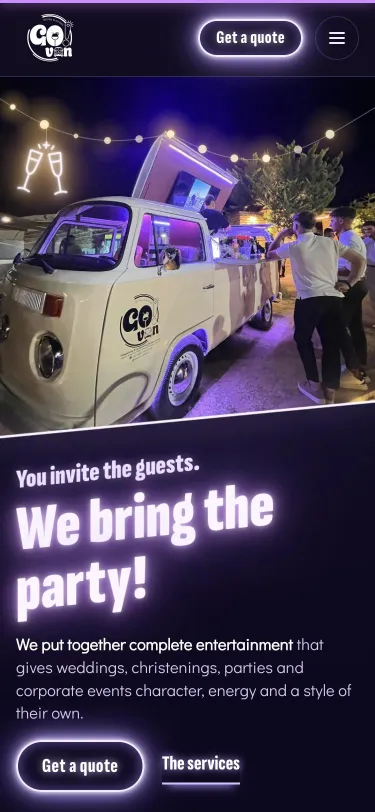
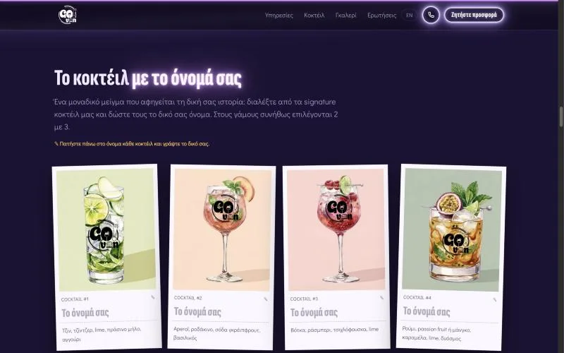
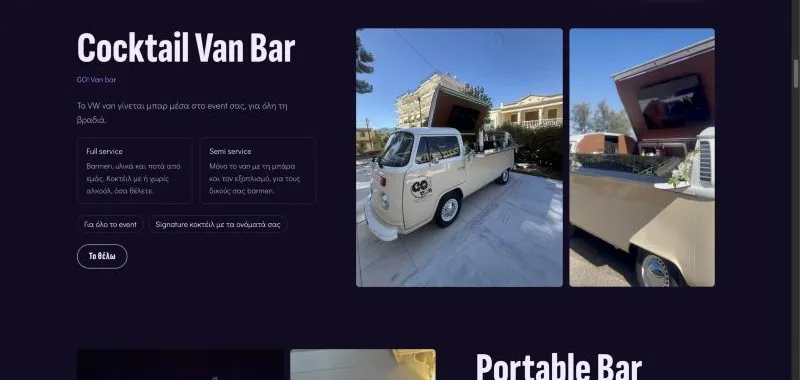
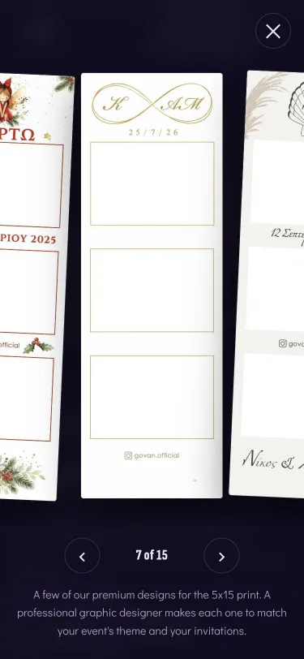

# govangreece.gr

Website for **GO! Van** (drinks & smiles), an event entertainment business in Laconia, Greece: 360 Video Booth, Mirror Photo Booth, Audio Guestbook and a cocktail bar in a vintage VW T2 van.

**Live:** [govangreece.gr](https://govangreece.gr) · [English](https://govangreece.gr/en)

<p>
  
  
</p>

The brief: a one-page site that works like an ad. Premium, not a template, night colours and neon like the van at an event, and one goal: get the visitor to ask for a quote. No prices, no booking calendar, no cookies.

## Highlights

- **Neon, without a library.** Titles that power on like neon signs, glowing tube buttons and a neon cut across the hero, built from CSS and inline SVG. Every animation respects `prefers-reduced-motion`.
- **Scroll feel, kept light.** Full-width photo "breaths" with parallax, reveals as you scroll and a looping services band, using CSS scroll-driven animations with an `IntersectionObserver` fallback. No scroll-jacking, no animation library.
- **Name your cocktail.** The signature cocktails are cards from the business's own watercolour menu: visitors type a name and it carries over to the quote form.
- **Print designs viewer.** The Mirror Photo Booth's 5x15 print designs drop in like prints tossed on a table, then swipe on phones and drag with a mouse on computers.
- **A quote form with no backend to run.** A Cloudflare Pages Function checks Cloudflare Turnstile and sends the email through Resend. Nothing is stored and there are no cookies.
- **Media pipeline.** Every photo and video is listed once in `media/media.config.mjs`, with its crop, sizes, alt text in both languages and people's consent. One command makes small WebP and MP4 files with all metadata (GPS included) stripped. CI blocks the launch while any face still waits for consent.
- **Greek first, English second.** Two typed dictionaries, so a missing translation fails the build. Each language has its own `<html lang>`, `hreflang` links and sitemap entry.
- **SEO for a business with no shop.** `LocalBusiness` JSON-LD with the areas it serves and no street address, Open Graph image, sitemap and robots.

<p>
  
  
  
</p>

**Lighthouse on mobile (live, November 2026):** Performance 94, Accessibility 100, Best Practices 100, SEO 100.

## Stack

Next.js 16 (App Router, static export), React 19, TypeScript, Tailwind CSS 4, Cloudflare Pages (with Pages Functions), Resend, Cloudflare Turnstile and Cloudflare Web Analytics (cookie-free). Fonts are served with the site through `next/font`.

## How it was built

In small steps, one pull request each: every PR got its own preview link, the client and the developer checked it on their phones, and only then did it merge into `dev`. Design changes were built as three working options side by side before one was picked. The site went live on 23 November 2026.

## Development

```bash
npm install      # also enables the git hooks in .githooks/
npm run dev      # http://localhost:3000
npm run build    # static site in out/
npm run lint
npm run typecheck
```

## Branches and deploys

- `main` is the live site at https://govangreece.gr. It only takes pull requests from `dev`.
- `dev` is the site in progress, at https://dev.govangreece.pages.dev.
- Each change is built on its own branch and opened as a pull request into `dev`. Every branch gets its own Cloudflare Pages preview link.
- CI (`.github/workflows/ci.yml`) runs on every pull request: lint, typecheck, build, and a gitleaks scan of the git history and of the built site.

## Content

- Business details (phone, email, social links) live in `lib/site.ts`. Only details the business already publishes belong there.
- All page text lives in `content/el.ts` (Greek, at `/`) and `content/en.ts` (English, at `/en`). Both satisfy the `Dictionary` type in `content/types.ts`, so a missing translation fails the build.
- Each language has its own root layout (`app/(el)/layout.tsx`, `app/(en)/en/layout.tsx`), so every page has the right `<html lang>`.

## Quote form

The form (`components/QuoteForm.tsx`) posts to `/api/quote`, a Cloudflare Pages Function (`functions/api/quote.ts`). It checks the Cloudflare Turnstile token, checks the fields with the same rules as the form (`lib/quote.ts`), and emails the request through Resend (`lib/quote-email.ts`). Nothing is stored.

Settings, in the Cloudflare dashboard under Pages > Settings > Variables and Secrets, for Production and Preview:

| Name | Kind | Value |
| --- | --- | --- |
| `RESEND_API_KEY` | Secret | Resend key with sending access only |
| `TURNSTILE_SECRET_KEY` | Secret | The Turnstile widget's secret key |
| `QUOTE_TO` | Variable | Production: the business inbox. Preview: the developer's own inbox, so tests never reach the client |

The Turnstile site key is public and lives in `lib/turnstile.ts`.

To try the form locally with the Function, put test values in `.dev.vars` (ignored by git): Cloudflare's always-pass Turnstile secret `1x0000000000000000000000000000000AA`, any `QUOTE_TO`, and `QUOTE_DRY_RUN=1`, which prints the email in the terminal instead of sending it. Then:

```bash
npm run build
npx --yes wrangler@4.151.3 pages dev out --compatibility-date=2026-10-19   # http://127.0.0.1:8788
```

## Photos and videos

The originals never enter the repo. `media/media.config.mjs` lists every photo and video on the site: source file, crop, sizes, alt text and consent.

```bash
npm run media                # rebuild all of public/media and lib/media.ts (macOS + ffmpeg)
npm run media -- service-    # rebuild only ids starting with "service-"
npm run check:media          # no EXIF/XMP/GPS in public/media (also runs in CI)
```

The picture shown when a link is shared (`public/og.jpg`) is made the same way, from the originals:

```bash
npm run og                   # rebuild public/og.jpg (scripts/og.mjs)
```

Originals are read from `MEDIA_SOURCE` (default `../photos/drive-2026-10-31`). Components use `<Photo>` and `<Clip>`.

People: children never appear. A recognizable adult is marked `consent: "pending"`, which is fine for previews, but CI blocks every pull request into `main` until it is `"ok"`.

## What never goes in this repo

The pre-commit hook (`.githooks/pre-commit`) checks these on every commit:

- Secrets: `.env*`, `.dev.vars`, API keys, tokens. They live in the Cloudflare dashboard (and `.dev.vars` locally, which is ignored).
- Original photos and videos. Only optimized WebP files, with metadata (EXIF, GPS) stripped.
- Design sources (`.psd`, `.ai`), client documents, private notes.
- Messages sent through the contact form.

## License

The code is under the MIT License. The photos, videos, logo, illustrations and texts belong to GO! Van and may not be reused. See [LICENSE](LICENSE).
